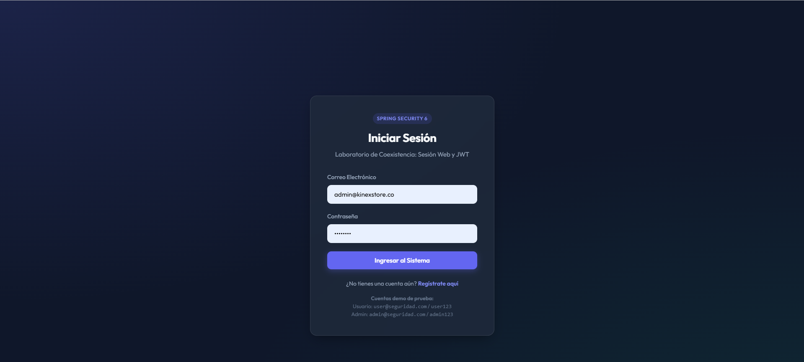
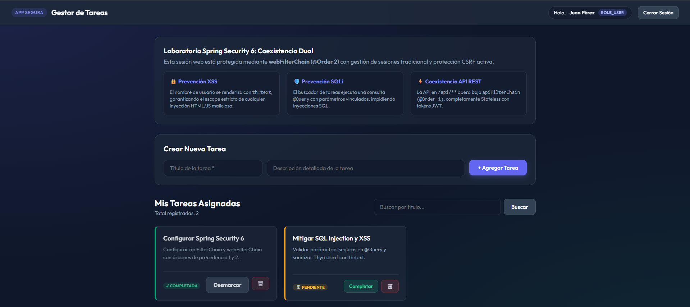
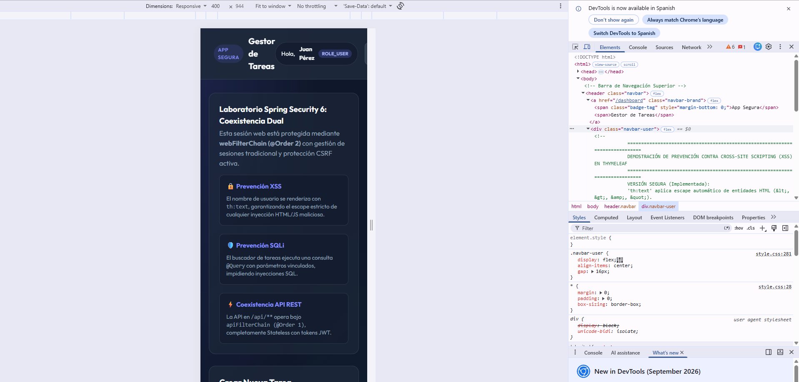
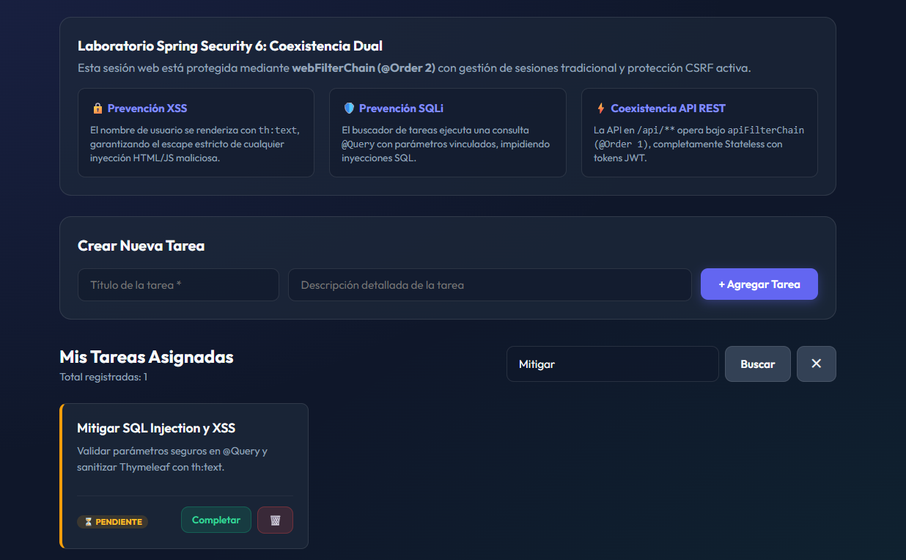
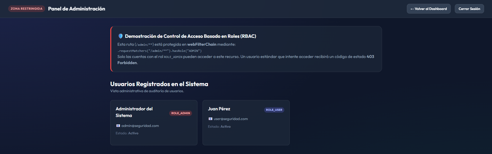
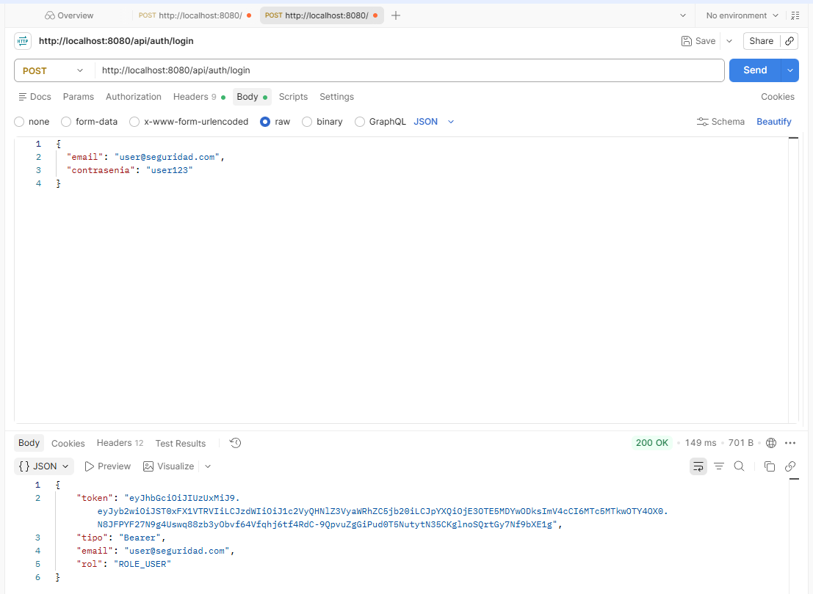
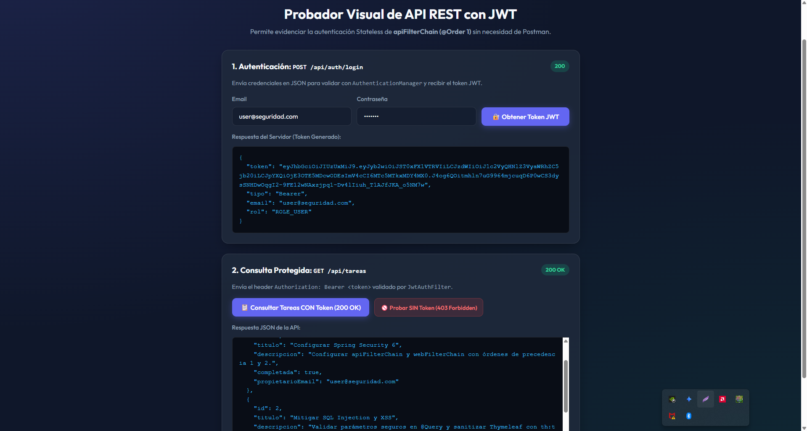

# 📸 Galería de Evidencias - Laboratorio Spring Security 6

Esta carpeta contiene las capturas de pantalla que sustentan la ejecución, verificación de seguridad y pruebas de la aplicación **seguridad-web**.

---

## 1. Autenticación Web y Form Login
Demostración del formulario de inicio de sesión gestionado por `webFilterChain (@Order 2)` con protección CSRF activa:

---

## 2. Panel de Control y Sesiones Web (Dashboard)
Sesión autenticada para el usuario estándar (`user@seguridad.com`), mostrando la bienvenida y las tareas asignadas:

---

## 3. Prevención de Cross-Site Scripting (XSS)
Inspección en el navegador (DevTools) demostrando el escape estricto de HTML mediante `th:text`:

---

## 4. Búsqueda Segura y Mitigación de SQL Injection
Búsqueda de tareas por título ejecutada a través de `@Query` parametrizado con `PreparedStatement`:

---

## 5. Control de Acceso Basado en Roles (`hasRole('ADMIN')`)
Demostración del acceso restringido a `/admin/panel` exclusivo para usuarios con `ROLE_ADMIN`:

---

## 6. Autenticación Stateless y Generación de Token JWT
Solicitud `POST /api/auth/login` validando credenciales y retornando el token JWT firmado con HMAC:

---

## 7. Consulta Protegida con Bearer Token JWT
Solicitud `GET /api/tareas` autenticada mediante el filtro `JwtAuthFilter` y retornando las tareas en formato JSON:

